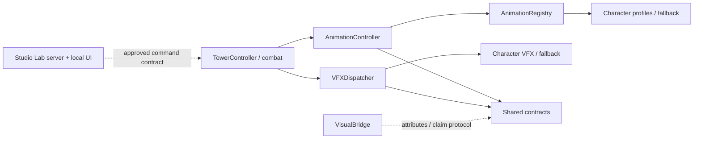

# PLAN-0005 — Phase 5: Character Model, Signature Animation, VFX & Animation Lab

- **สถานะ:** IMPLEMENTATION SCOPE AUTHORIZED — รอ AGY เริ่มงาน; Codex ตรวจรวมตอนท้าย; ยังไม่ใช่ VERIFIED/ACCEPTED/CLOSED
- **ติดตามสถานะ:** [กระดานกลาง](../../../TASKS.md) | **รายละเอียดงาน:** [tasks.md](tasks.md)
- **Baseline:** main @ d5d06216b2f8bc6ba43071d453709e0d3e0e8df4
- **ผู้ร้องขอ/ผู้อนุญาตลงมือ:** Stang ตามคำสั่งในแชต; อนุญาต implementation ของ Phase5 ทั้ง 34 งาน ไม่ใช่การรับรองงานหรืออนุมัติ technical decision ทุกค่าโดยปริยาย
- **ผู้จัดทำแผน/Reviewer:** Codex | **Implementer:** AGY Teamwork-preview — ยังไม่มอบหมาย session
- **Session/log:** ไม่มีข้อมูล session/log ID; อ้างอิงคำสั่งผู้ใช้ในแชตและไฟล์ต้นทาง
- **ต้นทาง:** [Phase 5 Master Pack](../../../requirement/phase5/phase_5_master_plan_and_agent_pack.md) §§0, Part 1–6
- **หลักฐานอนุญาตลงมือ:** คำสั่งผู้ใช้ 2026-10-17 (Asia/Bangkok): “ขอ prompt ให้ agy ทำงานให้เสร็จทุกแผนเลย แล้วนายรอ รีวิวทีเดียว”
- **อำนาจดำเนินการล่าสุด:** [HANDOFF](assets/HANDOFF.md) ระบุข้อจำกัดและวิธีจบทุก wave โดยไม่รอ Codex ตรวจราย wave; branch/worktree ยังไม่อนุญาต

## 1. เป้าหมายและอำนาจเอกสาร

ชุดนี้แปลงจาก Master Pack และได้รับคำสั่งให้ AGY ทำ Phase5 ครบ Core/Lab/Luffy/Zoro/Ace แล้วส่งตรวจรวมตอนท้าย อนุญาตเฉพาะ scope นี้ ยังไม่ใช่การรับรองผลเกมหรือยอมรับ spec drift การระบุ owner หมายถึง stream; ยังไม่มี AGY session ที่รับงานจริง

ยึด [AGENTS](../../../AGENTS.md), [READ](../../READ.md), [CONVENTIONS](../../CONVENTIONS.md), [CONTEXT](../../CONTEXT.md), [PRD](../../requirements/PRD.md), [TDD](../../technical/TDD.md), [API](../../technical/API.md) ก่อนข้อความตัวอย่างใน Master Pack หากขัดกันให้หยุดเฉพาะงานที่พึ่งข้อขัดแย้งนั้น

เอกสาร PRD/TDD/API/CONTEXT ปัจจุบันยังอธิบายระบบรุ่นแรก ขณะที่โค้ด baseline และ PROJECT.md มี Phase 3–4 แล้ว จึงใช้โค้ดเป็นหลักฐานพฤติกรรมปัจจุบัน ไม่ถือว่าโค้ดอนุมัติการขยายสเปกย้อนหลัง งานอัปเดตเอกสารเจ้าของเรื่องต้องผ่าน D-07 ก่อน

| รหัสความต้องการร่าง | ผลลัพธ์ที่ต้องการ | งานที่รองรับ | เกณฑ์ |
|---|---|---|---|
| P5-R01 | ตรวจรายการโมเดลครบ 19 และสถานะจากข้อมูลจริง | P5-00, P5-15 | G-01 |
| P5-R02 | rig ขยับได้ ไม่มี rigid path ล็อกอวัยวะ/อาวุธ | P5-03, P5-07, P5-08, L-01, Z-01, A-01 | G-02, G-03 |
| P5-R03 | procedural player แยกจาก combat, cancel/reset/scale ถูกต้อง | P5-03, P5-09, L-02, Z-02, A-02 | G-04 |
| P5-R04 | VFX รายตัว, Low/Medium/High, cap และ lifecycle | P5-04, P5-10, L-03, Z-03, A-03 | G-05, G-07 |
| P5-R05 | damage/cooldown/targeting/economy เดิมคงไว้ | P5-02, P5-11, P5-21 | G-06, G-11 |
| P5-R06 | Animation Lab เฉพาะ Studio มี model/camera/player/VFX/debug | P5-05, P5-12..P5-16 | G-01, G-04, G-05, G-08 |
| P5-R07 | stress 1/10/25/50, หลักฐาน memory/performance จริง | P5-16, P5-22 | G-07, G-09, G-10 |
| P5-R08 | ทำเฉพาะ Luffy/Zoro/Ace; รายการอื่นยังโหลดและ fallback ได้ | P5-06, P5-20, P5-21 | G-01, G-09, G-13 |

รหัส P5-Rxx เป็นรหัสติดตามของแผนร่าง ไม่ใช่ FR ใหม่ที่อนุมัติใน PRD แล้ว

## 2. Baseline ที่ตรวจแล้วและข้อจำกัด

- [CONFIRMED] อ่าน Git แบบ read-only: branch main, HEAD ตรง Master Pack, tracked working tree ไม่มี diff ตอนเริ่ม; มี untracked .vscode/ และ requirement/phase5/ อยู่ก่อน ห้ามลบ/รวม commit อัตโนมัติ
- [CONFIRMED] ตรวจ XML .rbxmx ทั้ง 19 ไฟล์: 12 heroes + 4 enemies + 3 map assets; ไม่มี serialized Motor6D/Weld ในทั้ง 19 ไฟล์ และ BasePart ทุกชิ้นตั้ง Anchored=true ใน template ดูตาราง [notes](notes.md)
- [CONFIRMED] ตัวเกมมี HeroSpec ใน GameConfig.HERO_CATALOG 8 ตัว แม้มี hero asset 12 ไฟล์ การเพิ่ม Nami/Usopp/Chopper/Robin เข้า gacha ไม่อยู่ในแผนนี้
- [CONFIRMED] TowerController มี runtime rig 7 Motor6D ในเส้นทาง AssetKit (ชื่อ comment ว่า 8-joint แต่จำนวนคำสั่งจริงคือ 7) และ VisualBridge อาจ clone skin ซ้อนแล้วซ่อน geometry เดิม ดู notes N-02
- [INFERRED] skin ที่ weld แบบแข็งและซ่อนชิ้นส่วน rig เดิมอาจทำให้ภาพที่เห็นไม่ขยับตาม rig ต้องพิสูจน์ใน Studio; ยังไม่ประกาศ confirmed runtime root cause
- [CONFIRMED] damage ถูกเรียกใน nested callback หลัง delay 0.14+0.10+0.07 = 0.31 วินาทีโดยประมาณจาก source ที่ :2002; delay 0.20 ที่ :2004 อยู่หลัง callback ห้ามนำมารวมเป็น damage delay
- **Static inspection:** ตรวจแล้วตามพิกัดใน notes; **Automated tests / Studio runtime / Visual:** NOT RUN / NOT VERIFIED ทั้งหมด รอบนี้ไม่มี application test

## 3. Scope Lock

### In scope ของแผนที่เสนอ

1. ปรับโมเดลเดิมเฉพาะ Luffy, Zoro, Ace; map อวัยวะจาก Part จริงไป canonical rig โดยไม่ยุบรายละเอียดโดยปริยาย
2. Shared AnimationContract/VFXContract; Track2 AnimationController, Registry, Dispatcher และ fallback
3. แยก visual จาก damage โดยรักษาผล/จังหวะ gameplay baseline รวม AoE, armor, crit, Whitebeard slow, sell/recall และ target snapshot
4. เปลี่ยนเฉพาะนโยบาย VisualBridge สำหรับ hero rig ให้มีผู้สร้าง visual/rig รายเดียว; map/enemy legacy path ไม่ถูกแปลงทั้งระบบ
5. Studio Animation Lab ตาม [สเปก Lab](assets/04-animation-lab-ui.md): 19 assets, workspace stage, camera, timeline, VFX, telemetry, stress และ controlled integration ที่แยก state
6. ชุดตรวจใน Node ที่มีอยู่และ Studio runtime spec ที่เสนอ พร้อมผลแยกประเภท; การเพิ่ม harness ต้องอยู่ใน D-05

### Out of scope

- signature สำหรับอีก 9 hero assets / 4 enemies; แผนรายตัวของ backlog, rebalance, เพิ่ม hero catalog, เปลี่ยน wave/economy/gacha/inventory
- enemy walk/rig rewrite ใน Track1; Lab อาจตรวจและรายงาน fallback/unsupported ตามจริง แต่ห้ามอ้างว่าปรับ enemy runtime แล้ว
- client animation/VFX migration ทั้งเกม, skinned mesh/Blender, uploaded AnimationId, curve editor, hot reload รับประกันอัตโนมัติ, publish/deploy
- การสร้าง branch/worktree/agent โดยไม่มีสิทธิ์เพิ่มเติม และการทดสอบแอป/แก้ src/asset โดย Codex; AGY ลงมือและทดสอบได้ตาม HANDOFF ล่าสุด

### Protected paths

src/Shared/GameConfig.luau, src/Track1_WaveSystem/**, src/Track3_UpgradeServer/**, src/Track3_UISystem/**, assets/rojo/EnemyModels/**, assets/rojo/MapModels/** และ hero อีก 9 ไฟล์ ห้ามแก้โดยไม่มี scope change ที่อนุมัติ

AGENTS.md / CONVENTIONS ยังห้ามแก้ ส่วน PRD/TDD/API/CONTEXT ให้ sync แบบเพิ่มเติมเฉพาะ Phase5 ที่ระบุใน HANDOFF §D-07 ซึ่ง Codex อนุญาตขอบเขตล่วงหน้าแล้ว การเปลี่ยน requirement เดิม/เพิ่ม feature/ปรับ scope นอกส่วนนั้นยังต้องเสนอ diff ให้ Codex อนุมัติก่อน; Codex ตรวจเอกสารทั้งหมดอย่างละเอียดรวมกับ code ตอนท้าย

## 4. สถาปัตยกรรมที่เสนอ

Track2 เป็นเจ้าของ combat และ animation runtime; Registry โหลด modules ภายใน Track2 แบบ dynamic ตาม alias ที่ระบุชัด เช่น Tower_Luffy_G5 -> Luffy ไม่ใช้ชื่อ gameplay ID หาไฟล์ตรงๆ

AnimationController รับ profile และบริหาร rig, pose evaluation, playback/cancel/reset, rest data ต่อ model; VFXDispatcher บริหาร cue, quality/cap, tracked resources ต่อ model โมดูลรายตัวให้ pose/VFX เท่านั้น ไม่มีสิทธิ์ลด HP

VisualBridge และ Track2 ต้องประสานผ่าน Shared Contract/attributes โดยไม่ require ข้าม Track ตามกฎเดิม นโยบาย skip/claim/ready และกรณี async order ต้องล็อกใน D-01 ก่อนแก้ การ require AnimationController จาก VisualBridge ตาม Master Pack เดิมยังไม่อนุญาต

Animation Lab แยก server runtime ออกจาก local UI/camera; ไม่ให้ LocalScript require modules ใน ServerScriptService โดยตรง และไม่ map server bootstrap ลง ServerStorage แล้วสมมุติว่าจะรันเอง รายละเอียดที่เสนอและประเด็นค้างอยู่ใน [contracts-and-integration](assets/contracts-and-integration.md)

แผนภาพ dependency ที่เสนอ (เส้นประคือสัญญาที่ยังต้องอนุมัติ ไม่ใช่ direct require):

## 5. จุดตัดสินใจก่อนอนุมัติลงมือ

| ID | ข้อขัดแย้ง/สิ่งที่ต้องตัดสินใจ | ข้อเสนอเพื่อให้ตรวจได้ | งานที่ถูกกั้น | สถานะ |
|---|---|---|---|---|
| D-01 | Master Pack ให้ VisualBridge require ข้าม Track และสร้าง visual ได้ซ้ำ | Track2 เป็น rig owner; Shared attributes ระบุเจ้าของและ readiness; bridge ไม่ clone/ซ่อน rig ที่ claim แล้ว; ต้องจัดการทั้ง bridge-first และ Track2-first | P5-03,07,08,11 | PROPOSED |
| D-02 | Lab ยังไม่มี client bootstrap / service mapping / ช่องทางเรียก server | ระบุ Rojo mapping ฝั่ง server/client แยกใน DevTools; เพิ่มเฉพาะ Studio command contract ผ่าน Shared; ไม่มี public production endpoint; ไม่แก้ HUD Track3 | P5-05,12..16 | PROPOSED |
| D-03 | damage timing ratio ตาม profile ในต้นทางขัดกับ preserve baseline | แยก combat timer โดยคง nominal impact 0.31s และ cadence/overlap เดิม; profile ห้ามเลื่อน damage; ถ้าจะเปลี่ยนต้อง CR | P5-02,11,21 | PROPOSED |
| D-04 | ขีดจำกัด parts 22/24/21 ต่ำกว่าโมเดลจริง 122/139/128 มาก | คงรายละเอียด baseline; วัด parts และเสนอ budget ใหม่ก่อน หรือขออนุมัติ asset reduction แยก ห้ามลบ geometry เพื่อให้ตัวเลขผ่าน | L-01,Z-01,A-01,P5-22 | PENDING OWNER DECISION |
| D-05 | ต้นทางระบุ .spec.luau แต่ repo มี Node .mjs ไม่มี runtime harness ที่ยืนยันแล้ว | ระบุวิธีรัน Studio TestService หรือ runner จริง, mapping test-only และ scope ไฟล์ harness ให้ตรวจได้ก่อนเขียน spec | P5-06,17,L/Z/A-04 | PROPOSED |
| D-06 | Controlled integration จะต้องใช้ reward guard ใน Track1 ซึ่งถูกห้ามแก้ | dummy ไม่เข้า Workspace.Enemies / ไม่ register reward listener; ใช้ seam ที่อยู่ใน Track2 พร้อมอนุมัติ command contract ถ้าทำไม่ได้ให้ block โหมดนี้ ไม่แก้ Track1 ลับๆ | P5-05,14,21 | PROPOSED |
| D-07 | เอกสาร canonical ล้าหลัง code; phase5 เป็นข้อเสนอใหม่ | ทำ reconciliation diff เฉพาะส่วน Phase5 และ invariant ที่จำเป็นให้ Codex ตรวจ และ Owner อนุมัติการเปลี่ยน spec ก่อน implementation; ไม่ rewrite เอกสารทั้งชุด | P5-01,23 | PENDING APPROVAL |
| D-08 | backlog source บางส่วนเรียก Phase5B–D บางส่วน Phase6 | คงทั้งหมดเป็น deferred ไม่กำหนดรุ่นส่งมอบ จน Owner อนุมัติแผนใหม่ | backlog เท่านั้น | PROPOSED |

ตารางข้างต้นบันทึกประเด็นจากรอบวางแผนเดิม คำสั่งล่าสุดอนุญาต implementation ทุก wave และให้ AGY ล็อกรายละเอียดทางวิศวกรรมภายในข้อจำกัดใน HANDOFF §Decision handling โดยไม่รอ Codex ราย wave ไม่ได้เปลี่ยน D-ID ทุกข้อเป็น Accepted โดยอัตโนมัติ โดยเฉพาะ budget ตัวเลขที่ยังไม่อนุมัติ ต้องไม่รายงานว่าผ่านแล้ว

## 6. Ownership ที่เสนอหลังอนุมัติ

| Stream | ผู้ลงมือที่เสนอ | Owned paths | Dependency |
|---|---|---|---|
| Core / integration | AGY-Core (ยังไม่มอบหมาย session) | src/Shared/{AnimationContract,VFXContract}.luau; src/AssetKit/VisualBridge.server.luau; src/Track2_TowerSystem/{TowerController.server,AnimationController,AnimationRegistry,VFXDispatcher}.luau; Animations/_FallbackProfile.luau; VFX/_FallbackVFX.luau; src/DevTools/AnimationLab/**; default.project.json; tests/phase5_core_and_lab.spec.luau | Wave0 decisions |
| Luffy | AGY-Char-Luffy (ยังไม่มอบหมาย session) | assets/rojo/HeroModels/Luffy.rbxmx; src/Track2_TowerSystem/Animations/Luffy.luau; VFX/LuffyVFX.luau ภายใต้ Track2; tests/characters/luffy_anim_vfx.spec.luau | Core interface + Lab ready |
| Zoro | AGY-Char-Zoro (ยังไม่มอบหมาย session) | assets/rojo/HeroModels/Zoro.rbxmx; src/Track2_TowerSystem/Animations/Zoro.luau; VFX/ZoroVFX.luau ภายใต้ Track2; tests/characters/zoro_anim_vfx.spec.luau | Core interface + Lab ready |
| Ace | AGY-Char-Ace (ยังไม่มอบหมาย session) | assets/rojo/HeroModels/Ace.rbxmx; src/Track2_TowerSystem/Animations/Ace.luau; VFX/AceVFX.luau ภายใต้ Track2; tests/characters/ace_anim_vfx.spec.luau | Core interface + Lab ready |
| Controller / review | Codex | แผน, HANDOFF, review-NNN; อ่าน diff และ evidence; ไม่ implement/test/commit/merge/deploy | actual ref + evidence |

โมเดล path ที่ชัดเจนข้างต้นแทน assets/Heroes/ และแก้ typo Animations/Zoro.rbxmx ในต้นทางเป็น Zoro.luau; ไม่ได้เพิ่มไฟล์ asset ใหม่ใน root

ชื่อ branch/worktree ในต้นทางเก็บเป็นตัวเลือกอนาคตเท่านั้น ไม่มีการเลือกสร้างหรืออนุมัติใช้รอบนี้ พอร์ต Phase5 ยังไม่จัดสรร ห้ามนำพอร์ตเดิมที่มี worktree ใช้งานอยู่ไปใช้พร้อมกัน

## 7. ลำดับ Wave และจุดส่งตรวจ

| Wave | งาน | ส่งมอบ/เงื่อนไขออก | งานถัดไป |
|---|---|---|---|
| Planning (ทำแล้ว) | แตกแผน, ตรวจ baseline/static XML, แสดงข้อขัดแย้ง | เอกสารครบ; คำสั่งใหม่อนุญาต implementation | AGY ทำ Wave0 |
| Wave0 — Contract lock | P5-00..06 | AGY ล็อก contract/runner ตาม HANDOFF และบันทึก D-ID ที่ยังเปิด | ทำ Wave1 ต่อเมื่อ internal gate พร้อม |
| Wave1 — Core & Lab | P5-07..17 | AGY ตรวจ core/rig/combat/Lab/cleanup ภายในและแก้ failure; Codex ยังไม่ review | ทำ Wave2 ต่อโดยไม่รอ Codex |
| Wave2 — Character batch1 | L-01..04, Z-01..04, A-01..04 | แต่ละตัวตรวจ state/VFX/reset ด้วย contract version เดียว; visual ที่ไม่มีผลจริงระบุ NOT VERIFIED | AGY ทำ Wave3 ต่อใน working tree เดียว |
| Wave3 — Integration & UAT | P5-20..23 | G-01..13 มีผลจริง, blocking finding แก้แล้ว, SHA ตรงกับสิ่งที่ตรวจ | Owner ตัดสินรับงานแยกจาก technical verdict |

รายละเอียด actions/dependency/AC/ผู้รับผิดชอบอยู่ tasks.md; แบ่ง streams เพื่อวางแผนเท่านั้น ไม่ให้สิทธิ์ spawn subagents หรือสร้าง branch

## 8. เกณฑ์ตรวจรับ 13 ข้อ

| Gate | สิ่งที่ต้องพิสูจน์ | วิธีตรวจ/งานรับผิดชอบ | สถานะ |
|---|---|---|---|
| G-01 | load/clone โมเดล 19 รายการ; 3 signatures + 16 อื่นคงใช้ได้; map ไม่ถูกบังคับมี rig | XML + Studio Model Explorer; P5-15,20 | NOT VERIFIED |
| G-02 | expected joints มี parent ถูก, actual limb/accessory CFrame เปลี่ยนหลัง step โดย root อยู่นิ่ง; ไม่มี rigid path ข้าม joint | Studio runtime mobility + static graph; P5-08,17, character -04 | NOT VERIFIED |
| G-03 | hat/cloud/swords/beads/dagger ตาม parent ถูกและไม่หลุด | Studio frame-step มุม front/side/back; character -04 | NOT VERIFIED |
| G-04 | cancel/Stop/seek/replay/scale/เร็วสุดคืน C0,C1,Size,attachments จาก rest; ไม่มี drift | deterministic pose spec + Studio; P5-09,14 | NOT VERIFIED |
| G-05 | cue ทิศทาง/ตำแหน่งตรง dummy, layers/quality ทำงาน, seek ไม่ยิง effect ซ้ำ | Studio VFX + lifecycle spec; P5-10,14 | NOT VERIFIED |
| G-06 | ปิด/ยิง VFX ซ้ำ/throw/cancel visual ไม่เปลี่ยน cadence, HP, crit RNG, splash/armor หรือทำ damage ซ้ำ; sell ยกเลิก pending hit ตาม baseline | controlled clock/seed traces เทียบ baseline + actual runtime; P5-02,11,21 | NOT VERIFIED |
| G-07 | Destroy/sell/reset/close ไม่เหลือ tracked tween/connection/task/VFX หรือ stale registry references | owner ledger + subtree diff หลัง TTL; P5-10,17,22 | NOT VERIFIED |
| G-08 | sandbox ไม่แตะเงิน, gacha, inventory, stats, wave/reward; production ไม่มี Lab command side effect | snapshot controlled state + non-Studio guard proof; P5-12,17,21 | NOT VERIFIED |
| G-09 | Luffy+Zoro+Ace+legacy ไม่แย่ง state; stress แยกจาก cap gameplay ปกติ | Studio mixed scenarios; P5-20,22 | NOT VERIFIED |
| G-10 | 1/10/25/50 มีค่าจริงและ budget ที่อนุมัติแล้ว ไม่เอา budget เดิมที่ขัดโมเดลมาตัดผ่าน | environment/quality/frametime/parts/peak/cleanup measurements; P5-22 | NOT VERIFIED |
| G-11 | existing Phase1–4 suites ที่มีจริงและ Phase5 suites รันครบตาม manifest; mock/static ไม่แทน runtime | AGY รายงาน command/cwd/ref/exit/status; P5-06,21 | NOT VERIFIED |
| G-12 | visual checklist 3 characters และ Lab ตรวจจริงโดยผู้ตรวจที่ระบุได้ | manual observation record; ไม่บังคับ screenshot/video; ถ้าไม่มีให้ NOT VERIFIED | NOT VERIFIED |
| G-13 | diff อยู่ใน ownership ที่อนุมัติ ไม่มี protected/scope/spec drift | Codex อ่าน git diff + เอกสารที่แก้ ณ actual SHA/ref; P5-23 | NOT VERIFIED |

ค่า tolerance ท่าและขนาดใช้ข้อเสนอ <0.001 จากสเปกตัวละคร; timing tolerance ต้องล็อกตามวิธีวัดและ Studio scheduler ใน Wave0 ไม่กล่าวว่าตรงเวลา 100% จาก static inspection

## 9. ความเสี่ยง / การย้อนกลับ

- ตัวอย่าง RigBuilder ในต้นทางลบ weld กว้างเกินไปและ assume ชื่อ R6 ที่ asset ไม่มี: ใช้ explicit semantic map + rigid graph ตรวจครบ ไม่ลบทุก weld ที่แตะ Head/Torso
- namespace/cache profile อาจเก็บ mutable state ร่วมกัน: profile data แยกจาก per-model context และไม่แก้ cached profile ตอนเล่น
- Part budget เดิมต่ำกว่า baseline หลายเท่า: D-04 ต้องตัดสินก่อนลด asset หรือใช้ budget รับงาน
- การย้าย damage ออกจาก nested visual callbacks อาจเปลี่ยน overlap/sell cancellation: ทำ baseline trace และ regression ก่อนเปลี่ยนเฉพาะ seam
- bootstrap และ camera/lighting เป็น local state: คืนกล้อง/input/postprocess ทุก exit path; ไม่บอกว่า Destroy server folder ลบข้อมูลที่ replicate ไปแล้วได้
- การย้อนกลับในอนาคตให้ AGY เสนอ diff คืนเฉพาะ Phase5 ที่ได้รับอนุญาต ห้าม reset working tree ผู้ใช้หรือย้อน unrelated work; merge/deploy ไม่อยู่ในสัญญานี้

## 10. Backlog ที่ยังไม่อนุมัติ

Shanks/Whitebeard/Law/Kizaru; Sanji/Nami/Usopp/Robin/Chopper; PirateGrunt/SoruAssassin/HakiBrute/YonkoBoss: เก็บแนวคิด signature ตาม Master Pack §4 เป็น deferred โดยยังไม่สร้างแผนรายตัวเพิ่มเติม และยังไม่กำหนด Phase5B/6 อย่างเป็นทางการ

## 11. Handoff และเอกสารท้ายแผน

[HANDOFF](assets/HANDOFF.md) อนุญาต AGY ทำ scope Phase5 ทุก wave ต่อเนื่องแล้วส่ง REVIEW READY ตอนท้าย ไม่มีสิทธิ์ AGY commit แม้เพื่อ SHA tracking; ใช้ฐาน Git หลัง commit เอกสาร handoff + working-tree diff และ hash เมื่อจำเป็น

P5-23 เป็นงานท้ายสุดสำหรับ sync เอกสารที่อนุมัติไว้กับสิ่งที่ทำจริง; ไม่เปลี่ยน scope/spec ย้อนหลังเพื่อทำให้ผลผ่าน Codex จะตรวจเอกสารและ actual ref ก่อนสรุป technical verdict ส่วน Owner acceptance ต้องมีหลักฐานต่างหาก
