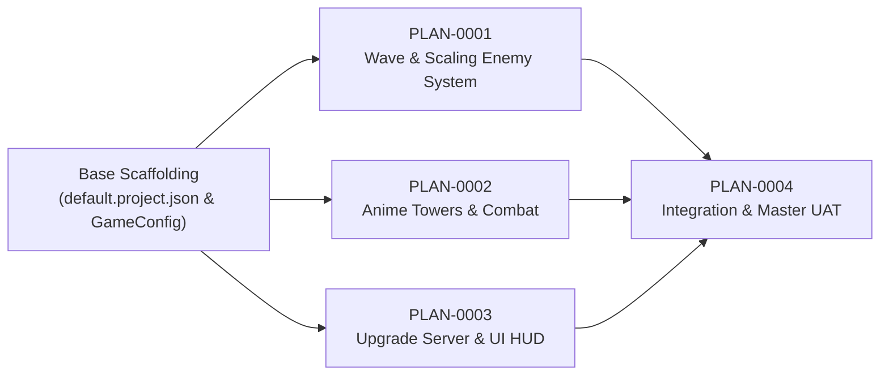

# แผนงานการพัฒนาและส่งมอบ (Implementation Plans Index)

ดัชนีแผนงานทั้งหมดของโปรเจกต์ Anime Limitless Tower Defense ตามหลักการ Modular Zero-Conflict Architecture:

| รหัสแผน | ชื่อแผนงาน | Scope / Target Path | Branch / Worktree | พอร์ต Rojo | สถานะ |
| :--- | :--- | :--- | :--- | :---: | :---: |
| [PLAN-0001](0001-core-wave-and-enemy-scaling/PLAN.md) | ระบบแกนหลักเวฟและซอมบี้สเกลไร้ขีดจำกัด | `src/Track1_WaveSystem/` | `feat/track1-wave` `../wt-track1-wave` | `34871` | Ready for Impl |
| [PLAN-0002](0002-anime-towers-and-combat/PLAN.md) | ระบบป้อมฮีโร่อนิเมะและการต่อสู้วิวัฒนาการ 4 ร่าง | `src/Track2_TowerSystem/` | `feat/track2-towers` `../wt-track2-towers` | `34872` | Ready for Impl |
| [PLAN-0003](0003-infinite-upgrade-and-ui/PLAN.md) | ระบบ UI HUD และเซิร์ฟเวอร์อัปเกรดไร้ขีดจำกัด | `src/Track3_UpgradeServer/` `src/Track3_UISystem/` | `feat/track3-ui` `../wt-track3-ui` | `34873` | Ready for Impl |
| [PLAN-0004](0004-multi-track-integration-and-uat/PLAN.md) | การผสานรวม 3 Track และตรวจรับ Master UAT | ทั้งโปรเจกต์ | `main` `./` | `34872` | Pending Deps |

## แผนภาพลำดับการทำงาน (Dependency & Execution Flow)

