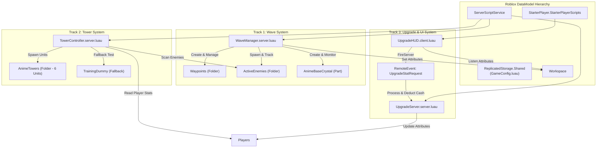
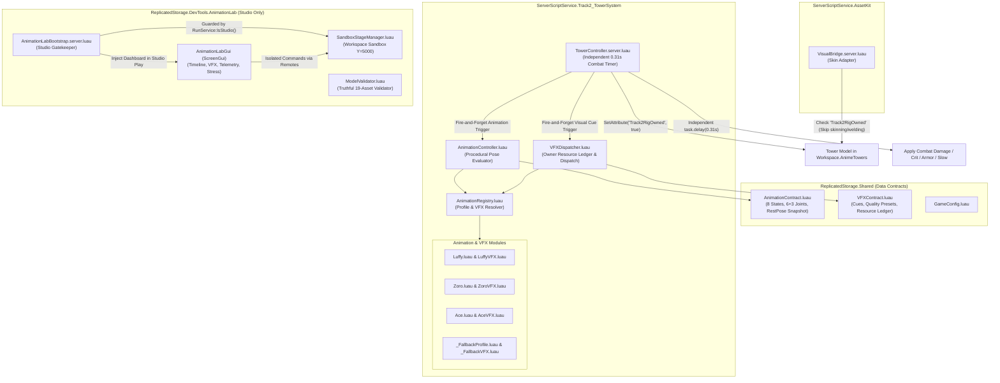

# เอกสารการออกแบบทางเทคนิค (Technical Design Document - TDD)

## 1. สถาปัตยกรรมระดับระบบ (System Architecture)



## 2. โมเดลการแยกหน้าที่และความรับผิดชอบ (Separation of Concerns)
- **Track 1**: รับผิดชอบวงรอบชีวิตของศัตรู, การเกิดเวฟ, การนับซอมบี้ที่เหลือ, เลือดฐาน และการมอบรางวัลเงินสด
- **Track 2**: รับผิดชอบการสแกนหาเป้าหมาย, การคำนวณระยะยิง, การปล่อยกระสุน/บีม, การสร้างดาเมจ และเอฟเฟกต์วิวัฒนาการ
- **Track 3**: รับผิดชอบการแลกเปลี่ยนเงินกับสเตตัส, การคำนวณราคาแบบทวีคูณ และการแสดงผล UI/HUD

## 3. ความปลอดภัยและประสิทธิภาพ (Safety & Performance)
- **No Physics Lag**: ซอมบี้และเอฟเฟกต์ยิงบีมใช้ `TweenService` หรือ `Anchored = true` เพื่อไม่สร้างภาระการคำนวณฟิสิกส์ให้ Roblox Physics Engine
- **Server Authority**: การหักเงินและการเพิ่มสเตตัสกระทำที่ฝั่ง Server ใน `UpgradeServer` เท่านั้น Client ไม่สามารถปลอมแปลงค่าสเตตัสได้

## 4. สถาปัตยกรรมระบบระยะที่ 5: โมเดล ริก แอนิเมชัน และเอฟเฟกต์ (Phase 5 Technical Architecture)

### 4.1 แผนภาพสถาปัตยกรรมและการเชื่อมต่อ (Integration Architecture & Seam Diagram)



### 4.2 กลไกการเป็นเจ้าของริกเดี่ยว (Single Visual Ownership Seam — D-01)
- **ปัญหาเดิม**: `VisualBridge.server.luau` จะทำการ Clone โมเดลสกินทับ (`AssetKitVisuals`) และสร้าง `WeldConstraint` เชื่อมทุก `BasePart` เข้ากับ `root` ส่งผลให้ข้อต่อ `Motor6D` ที่สร้างโดย `TowerController` ถูกล็อกแข็ง ไม่สามารถเคลื่อนไหวได้
- **แนวทางแก้ไข (Single Rig Owner)**:
  1. `TowerController.server.luau` เป็นผู้ถือสิทธิ์การสร้างและควบคุม Rig (`RigOwner`) เพียงผู้เดียว
  2. เมื่อ Tower ถูกสร้างขึ้น `TowerController` จะทำการกำหนด Attribute:
     ```luau
     towerModel:SetAttribute("Track2RigOwned", true)
     ```
  3. `VisualBridge.server.luau` จะตรวจสอบ Attribute นี้ตั้งแต่ต้น:
     ```luau
     if model:GetAttribute("Track2RigOwned") then
         return -- ข้ามกระบวนการ Clone และ Root-Weld โดยสิ้นเชิง
     end
     ```
  4. จัดการปัญหาวงรอบการทำงานแบบ異จังหวะ (Idempotent Rebind): ไม่ว่า `VisualBridge` หรือ `TowerController` จะเริ่มทำงานก่อน สิทธิ์ของ `Track2RigOwned` จะมีผลสูงสุดเสมอ

### 4.3 การแยกวงจรรบออกจากแอนิเมชันและเอฟเฟกต์ (Combat & Visual Decoupling Seam — D-03)
- **สถาปัตยกรรมตัวจับเวลาการต่อสู้อิสระ (Independent Combat Oracle)**:
  - จังหวะการโจมตีทางเซิร์ฟเวอร์ยึดตาม Nominal Hit Timing Baseline:
    $$\Delta t_{\text{impact}} = 0.14\text{s (Wind-up)} + 0.10\text{s (Dash)} + 0.07\text{s (Hitstop)} = 0.31\text{s}$$
  - เมื่อยูนิตเริ่มโจมตี:
    1. เซิร์ฟเวอร์จะสั่งทริกเกอร์แอนิเมชันและ VFX แบบ **Fire-and-Forget**:
       ```luau
       AnimationController:PlayAttack(towerInstance, heroSpec)
       VFXDispatcher:TriggerCue(towerInstance, "AttackWindup", vfxContext)
       ```
    2. เซิร์ฟเวอร์จัดคิวงานหน่วงเวลาที่แท้จริงแยกต่างหาก:
       ```luau
       task.delay(0.31, function()
           if not towerInstance.Parent or not rootPart.Parent then return end
           applyCombatHit(towerInstance, capturedTargetPos, heroSpec)
       end)
       ```
- **การป้องกันความผิดพลาดของภาพกระทบระบบเกม (Visual Failure Isolation)**:
  - หากแอนิเมชันถูก Pause, Seek, Cancel, ปรับลด Speed หรือมี Error เกิดขึ้นในโมดูล VFX ฟังก์ชัน `applyCombatHit` จะยังคงทำงานตรงเวลาที่ 0.31s เสมอ
  - โมดูลแอนิเมชันและ VFX ไม่มีสิทธิ์เข้าถึงหรือเรียกฟังก์ชันลดเลือด (`ApplyDamage`) หรือเปลี่ยนแปลงค่าสเตตัสใดๆ ในเกม
  - กรณีผู้เล่นขายหรือทำลายป้อม (Sell/Recall) ก่อนเวลา 0.31s ระบบจะตรวจสอบ `tower.Parent` และยกเลิกการทำดาเมจ พร้อมส่งสัญญาณล้าง VFX ทันที

### 4.4 โครงสร้างและการกั้นความปลอดภัยของห้องทดลอง (Animation Lab Architecture & Studio Isolation — D-02, D-06)
- **การตัดการทำงานบนเซิร์ฟเวอร์จริง (Production Lockout Guard)**:
  - โมดูลทั้งหมดใน `src/DevTools/AnimationLab/**` ได้รับการป้องกันตั้งแต่บรรทัดแรก:
    ```luau
    local RunService = game:GetService("RunService")
    if not RunService:IsStudio() then
        return {} -- คืนค่าตารางว่างทันทีใน Production เพื่อไม่ให้สร้าง Instance, Remote หรือ Listener ใดๆ
    end
    ```
- **การแยกพื้นที่เวทีทดสอบ (Isolated Workspace Sandbox Stage)**:
  - เวทีทดสอบ 3 มิติ `Workspace.__AnimationLabSandbox` สร้างขึ้นที่พิกัด `Vector3.new(0, 5000, 0)` ห่างจากแผนที่เกมหลัก 5,000 Studs
  - จัดการขอบเขตแบบแยกเซสชัน (`Workspace.__AnimationLabSandbox.<SessionId>`)
  - หุ่นทดสอบจำลอง (Dummy Target) ติดตั้ง Attribute `IsAnimationLabDummy = true` โดยไม่ถูกเพิ่มเข้าโฟลเดอร์ `Workspace.ActiveEnemies` และไม่มีการผูกเข้ากับระบบเงินรางวัลของ `WaveManager`
- **การคืนค่าสภาพแวดล้อมสมบูรณ์ (State & Camera Restoration)**:
  - เมื่อเปิดใช้งาน Lab ระบบจะบันทึกสถานะกล้องเดิม (`CameraType`, `CFrame`, `FieldOfView`) และเมื่อปิด Lab จะคืนค่ากล้องและทำลาย Instance ทั้งหมดบน Sandbox ทันที
