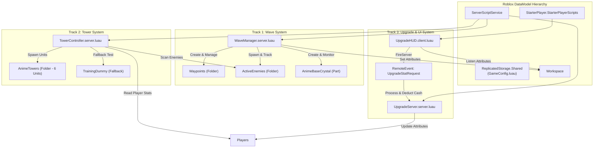

# เอกสารการออกแบบทางเทคนิค (Technical Design Document - TDD)

## 1. สถาปัตยกรรมระดับระบบ (System Architecture)

## 2. โมเดลการแยกหน้าที่และความรับผิดชอบ (Separation of Concerns)
- **Track 1**: รับผิดชอบวงรอบชีวิตของศัตรู, การเกิดเวฟ, การนับซอมบี้ที่เหลือ, เลือดฐาน และการมอบรางวัลเงินสด
- **Track 2**: รับผิดชอบการสแกนหาเป้าหมาย, การคำนวณระยะยิง, การปล่อยกระสุน/บีม, การสร้างดาเมจ และเอฟเฟกต์วิวัฒนาการ
- **Track 3**: รับผิดชอบการแลกเปลี่ยนเงินกับสเตตัส, การคำนวณราคาแบบทวีคูณ และการแสดงผล UI/HUD

## 3. ความปลอดภัยและประสิทธิภาพ (Safety & Performance)
- **No Physics Lag**: ซอมบี้และเอฟเฟกต์ยิงบีมใช้ `TweenService` หรือ `Anchored = true` เพื่อไม่สร้างภาระการคำนวณฟิสิกส์ให้ Roblox Physics Engine
- **Server Authority**: การหักเงินและการเพิ่มสเตตัสกระทำที่ฝั่ง Server ใน `UpgradeServer` เท่านั้น Client ไม่สามารถปลอมแปลงค่าสเตตัสได้
